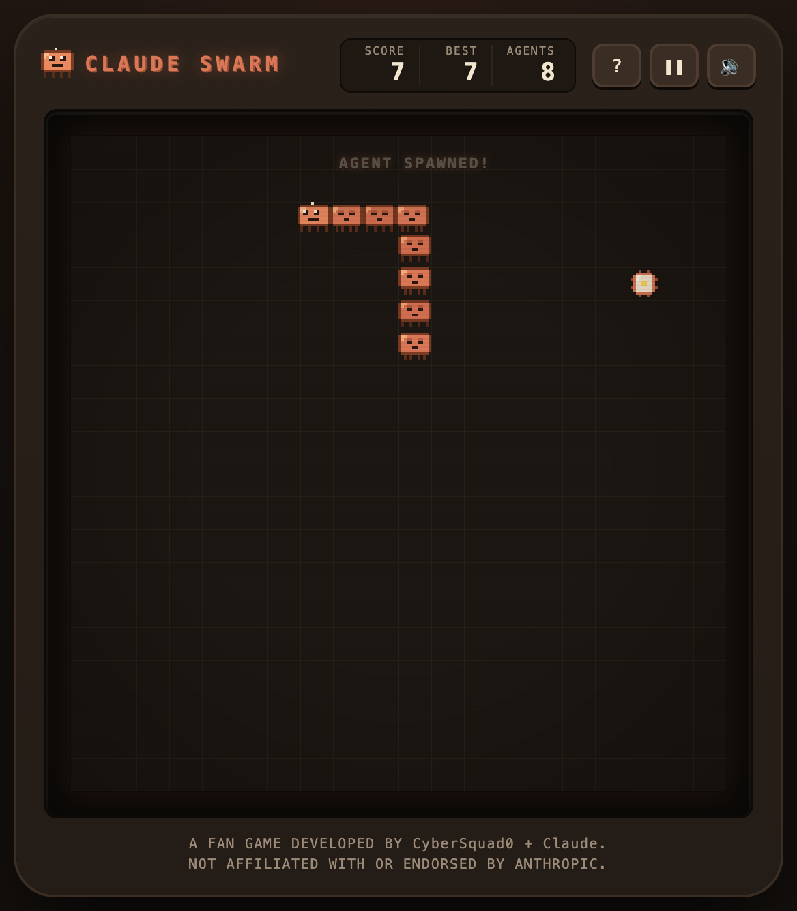
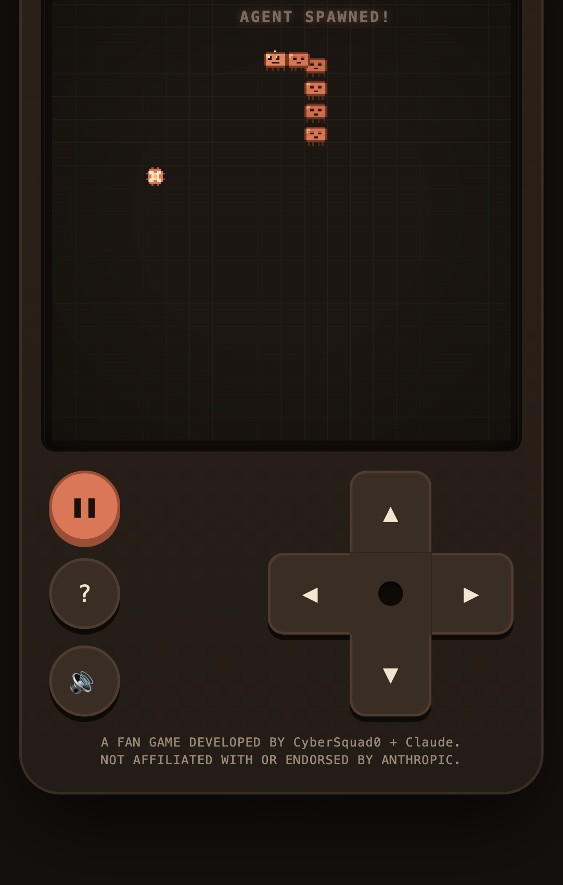

<p align="center">
  
</p>

<h1 align="center">Claude Swarm</h1>

<p align="center"><strong>Consume tokens. Spawn agents. Grow your swarm.</strong></p>

<p align="center">A free retro arcade fan game inspired by Nokia’s Snake, for desktop and mobile.</p>

<p align="center">
  <a href="https://meridian-knight.github.io/claude-swarm/"><strong>▶ Play now: meridian-knight.github.io/claude-swarm</strong></a>
</p>

<p align="center">
  <a href="https://github.com/meridian-knight/claude-swarm/actions/workflows/deploy-pages.yml"></a>
</p>

<table align="center">
  <tr>
    <td align="center" valign="top">
      
    </td>
    <td align="center" valign="top">
      
    </td>
  </tr>
</table>

## How to play

1. **Consume tokens** to score.
2. **Every token spawns an agent** into your swarm. The swarm follows your every turn.
3. **Avoid the walls and your own swarm.** Fill the whole board to win.

The swarm speeds up as it grows. Your best score and the sound setting are remembered in your browser only.

| | Move | Pause / Resume | Start / Restart | Help |
|---|---|---|---|---|
| **Desktop** | Arrow keys or WASD | Space | Enter | `?` button |
| **Touch** | D-pad on the right, or swipe the board | Pause button (left) | Tap Start | Help button (left) |

Sound starts after your first tap or key press. On iPhone the ring/silent switch also applies. Short vibration feedback plays on phones whose browser supports it (Android Chrome); iOS has no vibration API, so nothing is promised there.

## Under the hood

- Static site: Vite + TypeScript, no backend, no accounts, no AI API, no network requests once loaded.
- “Agents” is the game’s name for its characters. They are canvas sprites drawn from 12×12 pixel grids, not AI agents.
- Game rules live in `src/game/` as pure functions with their own unit tests; rendering, input, audio and layout live in `src/ui/`.
- A Content Security Policy meta tag ships with the production page.

## Develop

```bash
npm install
npm run dev          # http://127.0.0.1:5173/
npm run typecheck
npm test             # unit tests (Vitest)
npm run test:e2e     # browser tests (Playwright, desktop + mobile matrix)
npm run build        # production build in dist/
npm run preview      # serve dist/ locally
```

`npm run test:e2e` needs Playwright’s Chromium: `npx playwright install chromium`.

## Deploy

Pushing to `main` runs [`.github/workflows/deploy-pages.yml`](.github/workflows/deploy-pages.yml), which installs from the lockfile, typechecks, runs the unit tests, builds, and publishes `dist/` to GitHub Pages (repository setting: Pages → Source → GitHub Actions). Asset paths are relative, so the build works at a domain root or under the repository sub-path.

To roll back, revert the offending commits on `main` and push; Pages keeps serving the last successful deployment until the new run finishes.

## Credits

A fan game developed by **CyberSquad0** + **Claude**.

Not affiliated with or endorsed by Anthropic. Not affiliated with Nokia.
